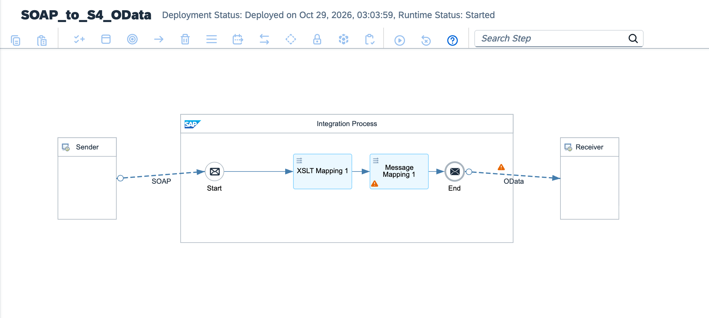

# Enterprise Oil & Gas Modernization: Legacy PI/PO SCADA Telemetry Migration to SAP BTP via Cloud Connector & X.509 Principal Propagation

[](https://www.sap.com)
[](https://www.sap.com)
[](https://opcfoundation.org)
[](https://help.sap.com)
[](https://www.sap.com)

---

## Executive Summary

Upstream drilling rigs, subsea pipeline distribution systems, and downstream refining facilities generate continuous high-frequency operational technology (OT) telemetry (flow velocity, pipe pressure, thermal gradients, acoustic vibration). Historical integration architectures deployed on legacy SAP Process Orchestration (PO 7.5) connected SCADA systems using insecure shared database links, unencrypted direct RFC calls, and custom ABAP Z-functions. These created catastrophic OT/IT attack surfaces, maintenance downtime during ERP upgrades, and delayed predictive maintenance.

This architecture establishes a **Mission-Critical Zero-Trust OT/IT Bridge**:
1. **Decommissioning Legacy PI/PO Footprints:** Replaces obsolete PI/PO dual-stack adapters with Cloud Integration runtime flows connected via **SAP BTP Cloud Connector**.
2. **X.509 Principal Propagation:** Enforces mutual certificate-based identity propagation without exposing technical service account credentials or opening inbound firewall ports on-premises.
3. **In-Flight OT Calibration & Physics Validation:** Evaluates pressure/temperature excursions, sensor calibration drifts, and casing strain rates in memory using optimized Groovy rule engines before ERP commitment.
4. **Clean Core Asset Maintenance Postings:** Automatically routes verified readings to SAP S/4HANA Plant Maintenance (PM) via standard **OData V4 Measurement Document APIs**, updating equipment measuring points without modifying core ERP logic.
5. **Critical OT Excursion & Safety DLQ:** Quarantines abnormal sensor spikes (`PressureDelta > 25%`) or communication timeouts into an encrypted Dead-Letter Queue (DLQ), instantly alerting operational reliability engineers before pipeline blowout risks occur.

---

## Architecture Overview



### High-Level Topology

```text
[Offshore Platforms / SCADA Historians / OPC-UA Gateways]
          │
          │ HTTPS POST (TLS 1.3 / Mutual Certificate)
          │ Endpoint: /oilgas/scada/telemetry/ingest
          ▼
[SAP Integration Suite: IF_OilGas_SCADA_Telemetry_to_S4HANA_CleanCore]
  │
  ├── 1. Context & OT Provenance Initialization (CM_Init_OT_Context):
  │    └─ Injects Rig/Platform ID, Wellhead GUID, Sensor Calibration Profile, and UTC Timestamps
  │
  ├── 2. In-Flight Calibration & Safety Gatekeeper (Validate_SCADA_Telemetry.groovy):
  │    ├─ Computes psi to bar conversions and thermal normalization
  │    ├─ Detects abnormal casing pressure spikes (Blowout Prevention rules)
  │    └─ Sets status: SAFE_OPERATIONAL or SAFETY_CRITICAL_EXCURSION
  │
  ├── 3. OT Integrity Router (Router_OT_Safety):
  │    │
  │    ├──► [Safety Critical Anomaly] ──► CM_Safety_Alert ──► Quarantined Safety DLQ
  │    │      └─ Halts automated batch posting; alerts on-call field engineering
  │    │
  │    └──► [Operational Norm] ──► Continue to ERP Clean Core Commit
  │
  ├── 4. Clean Core Payload Builder (Build_S4HANA_Measurement_Doc.groovy):
  │    └─ Maps engineering units to S/4HANA Measuring Point & Counter structures
  │
  ├── 5. Outbound S/4HANA Dispatch (via SAP BTP Cloud Connector):
  │    └─ HTTP OData V4 Adapter (/sap/opu/odata4/sap/api_measurementdocument/srvd_a2x)
  │    └─ Authentication: Principal Propagation (X.509 User Certificate)
  │
  └── 6. Exception Subprocess (Format_OilGas_OT_DLQ.groovy):
       └─ Dumps runtime network timeouts or schema corruptions to forensic audit store
```

---

## Technical Specifications

| Architectural Dimension | Legacy SAP PI/PO Dual-Stack Architecture | Cloud-Native Clean Core OT/IT Pipeline |
| :--- | :--- | :--- |
| **Connectivity** | Static on-premises RFC / JCo connections | SAP BTP Cloud Connector with encrypted TLS reverse tunnel |
| **Authentication** | Hardcoded technical ERP service users | **X.509 Principal Propagation** (short-lived client certificates) |
| **Network Boundary** | Permissive firewall rules between IT and OT | Strict Zero-Trust demilitarized zone (DMZ) perimeter |
| **Telemetry Parsing** | Invasive ABAP Z-programs and batch DB staging | In-flight Groovy telemetry normalization & threshold parsing |
| **Asset Maintenance** | Direct BAPI_ALM_MEASUREMENTDOC_CREATE calls | Clean Core standard transactional **OData V4** services |
| **Fault Isolation** | Stuck SM58 queues block all subsequent readings | Asynchronous DLQ routing with immediate industrial alarms |

---

## Sample Data Structures

### 1. Inbound Industrial SCADA Telemetry Frame
```json
{
  "telemetryHeader": {
    "platformId": "OFFSHORE-RIG-NORTH-SEA-09",
    "wellheadId": "WELL-DEV-44B",
    "scadaHistorianNode": "HIST-NODE-01",
    "timestampUTC": "2026-11-08T00:01:30Z"
  },
  "readings": [
    {
      "sensorId": "PRESS-TRANSDUCER-401",
      "measuringPointTag": "MP-99410-PSI",
      "sensorType": "WELLHEAD_CASING_PRESSURE",
      "rawReading": 4210.5,
      "engineeringUnit": "PSI",
      "calibratedBarValue": 290.3,
      "operatingStatus": "OPTIMAL"
    },
    {
      "sensorId": "THERM-WELLHEAD-102",
      "measuringPointTag": "MP-99411-TEMP",
      "sensorType": "WELLHEAD_CHOKE_TEMPERATURE",
      "rawReading": 78.4,
      "engineeringUnit": "CELSIUS",
      "operatingStatus": "OPTIMAL"
    }
  ]
}
```

### 2. S/4HANA Clean Core Measurement Document (OData V4)
```json
{
  "MeasuringPoint": "000000010482",
  "MeasurementReadingDate": "2026-11-08",
  "MeasurementReadingTime": "00:01:30",
  "MeasurementReading": 290.3,
  "MeasurementReadingInEntryUnit": "BAR",
  "CharacteristicName": "CASING_PRESSURE",
  "MeasurementDocumentText": "SCADA Telemetry Rig-09 / Auto-Generated Clean Core",
  "MeasurementDocumentIsDifference": false,
  "Equipment": "EQUIP-WELL-SUBSEA-09",
  "ShortText": "Automated OT-to-Cloud Integration Suite Feed"
}
```

---

## Repository Structure

```text
├── README.md                                             # Enterprise architecture & operations runbook
├── sap-cpi-oilgas-cleancore-runtime-architecture.png    # Integration flow runtime topology diagram
├── ADR-010-OilGas-Legacy-PIPO-Migration-CloudConnector.md # Architecture Decision Record
├── IF_OilGas_SCADA_Telemetry_to_S4HANA_CleanCore.zip     # Production iFlow runtime bundle export
├── cpi/
│   └── scripts/
│       ├── Validate_SCADA_Telemetry.groovy               # Calibration, unit conversion & blowout threshold checks
│       ├── Build_S4HANA_Measurement_Doc.groovy          # Canonical OData V4 measurement document builder
│       └── Format_OilGas_OT_DLQ.groovy                   # Industrial telemetry exception & safety handler
├── tests/
│   ├── sample_valid_scada_stream.json                    # Compliant rig telemetry test payload
│   └── sample_critical_pressure_excursion.json           # Safety excursion payload triggering quarantine DLQ
└── .gitignore                                            # Git exclusion rules
```

---

## Verification & Deployment Runbook

### 1. Inbound Endpoint Verification
Verify runtime status in **Monitor** ──► **Manage Integration Content**:
```text
https://<tenant-runtime>.cfapps.<region>[.hana.ondemand.com/http/oilgas/scada/telemetry/ingest](https://.hana.ondemand.com/http/oilgas/scada/telemetry/ingest)
```

### 2. Dispatched cURL Test (Happy Path)
Execute an authorized POST request using valid SCADA wellhead telemetry:

```bash
curl -X POST \
  'https://<tenant-runtime>.cfapps.<region>[.hana.ondemand.com/http/oilgas/scada/telemetry/ingest](https://.hana.ondemand.com/http/oilgas/scada/telemetry/ingest)' \
  -H 'Content-Type: application/json' \
  -H 'Authorization: Bearer <BTP_OAUTH_TOKEN>' \
  --data-binary '@tests/sample_valid_scada_stream.json'
```

### 3. Monitoring Trace
* Inspect execution under **Monitor Message Processing**.
* Verify properties `Safety_Status = SAFE_OPERATIONAL`, `Wellhead_ID = WELL-DEV-44B`, and `S4HANA_Measurement_Doc_ID`.
* Confirm that HTTP 201 Created is returned via the SAP BTP Cloud Connector with valid X.509 Principal Propagation audit records.

---

## Author

**Željko Popov**  
*Integration Architect | SAP Integration Suite & Clean Core Specialist*  
[GitHub Repositories](https://github.com/neurozeljko)
